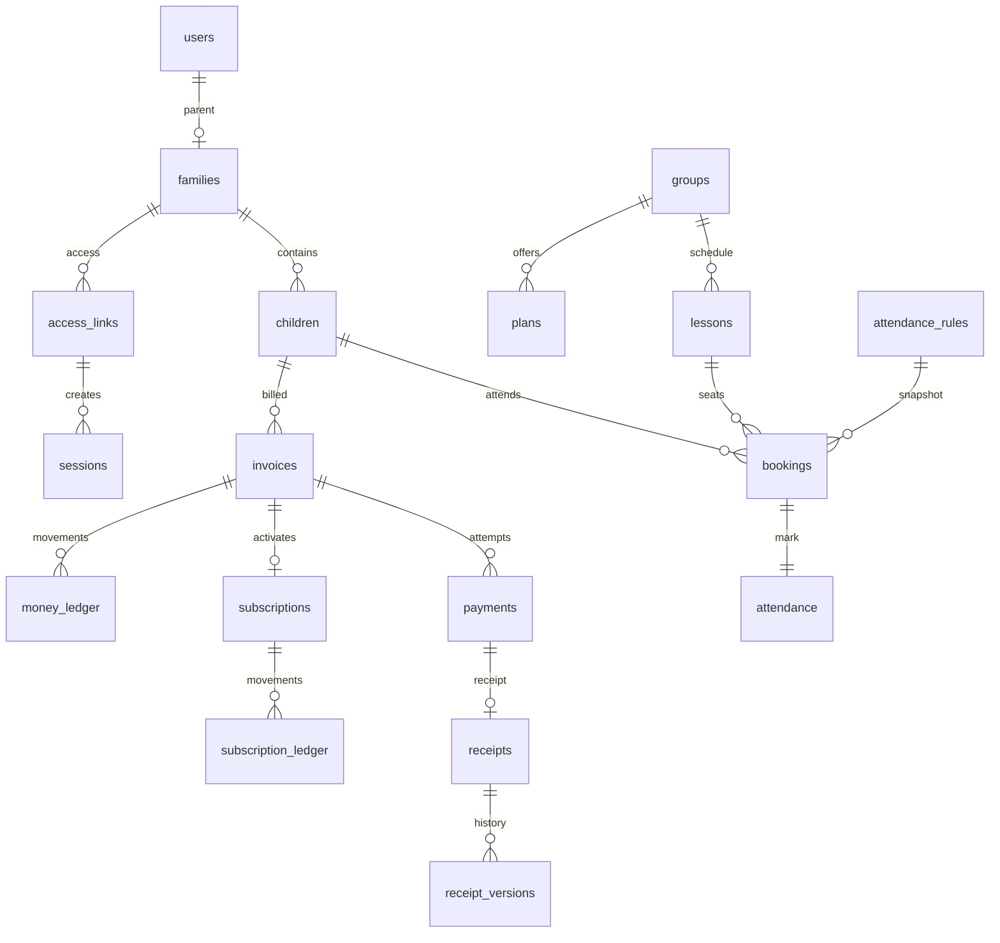

# База данных бэкенда

Исходные `BD.sql` и `BD.svg` сохранены без изменений. Они описывают предыдущую редакцию проекта и не являются миграцией реализованного сервера.

Актуальная установка: `backend/internal/database/migrations/001_init.sql`. Миграция создаёт отдельную PostgreSQL-схему **jasna**, применяется на старте и регистрируется в `jasna.schema_migrations`. Таблицы исходной схемы `public`, если они уже существуют, не изменяются. Автоматического переноса старых данных нет: для существующей рабочей базы потребуется отдельная миграция данных с проверкой соответствия.

## Соответствие исходной модели

| Исходная модель | Реализация |
| --- | --- |
| `users`, обязательный уникальный email | `users`: необязательные контакты, отдельный логин и Argon2id-хеш мастера. |
| Одноразовые `access_tokens` | Повторно используемые отзываемые `access_links` семьи; `sessions` ссылается на ссылку. |
| `families`, `children` | Сохранены сущности, добавлена архивация ребёнка и версии объектов. |
| `groups`, `lessons` | Вместимость копируется в конкретное занятие; изменение группы не меняет старое расписание. |
| Статусные `attendance_rules` | Версия полной политики: списание, отмена, перенос, цена разового занятия и пороги напоминаний. |
| Полный UNIQUE на запись | Частичный UNIQUE только для активной записи ребёнка на занятие. |
| `attendance` | Общий статус `cancelled` и причина; ссылка на фактический финансовый эффект. |
| `subscriptions`, `subscription_ledger` | Сохранены; абонемент связан со счётом/группой, остаток обновляет единственный триггер. |
| Платёж с произвольной суммой/назначением | `plans` → `invoices` → `payments`; цена фиксируется сервером в снимке тарифа. |
| Денежный баланс отсутствует | `money_ledger`: счета, оплаты и компенсирующие движения. |
| Публичные `receipts.file_url` | Закрытое содержимое `bytea` или разрешённая внешняя ссылка; `receipt_versions` хранит замены. |
| `notifications`, `audit_log` | Добавлены транзакционный `outbox` и хранилище ключей идемпотентности. |
| `waitlist_entries` | Не создаётся: лист ожидания относится к дополнительному этапу. |

## Основные связи



Суммы — `bigint` в копейках; float не используется. Даты действия абонемента включительны. Временные отметки — `timestamptz`, бизнес-зона — `Asia/Yekaterinburg`.

Одна оплаченная покупка создаёт один абонемент благодаря UNIQUE на `subscriptions.invoice_id`. Первичное начисление занятий и зачисление оплаты имеют отдельные уникальные индексы. История денежных и учебных движений неизменяема; исправления добавляют обратную запись. CHECK не допускает отрицательный остаток занятий.

Все изменения API и фоновых задач выполняются с одной транзакционной advisory-блокировкой `7341022`. Миграции используют отдельную блокировку `7341021`. Это сериализация записей на уровне всей небольшой мастерской; она охватывает и конкурентные процессы. Запросы к провайдеру выполняются вне транзакции.

## Проверка согласованности

Выполнять в актуальной БД:

```sql
-- Должно вернуть 0 строк.
SELECT s.id, s.lessons_remaining, coalesce(sum(l.delta), 0) AS calculated
FROM jasna.subscriptions s
LEFT JOIN jasna.subscription_ledger l ON l.subscription_id = s.id
GROUP BY s.id
HAVING s.lessons_remaining <> coalesce(sum(l.delta), 0);

-- Денежный баланс семьи: положительный — кредит, отрицательный — долг.
SELECT family_id, sum(amount_minor) AS balance_minor
FROM jasna.money_ledger
GROUP BY family_id;
```

Задолженность вычисляется по неоплаченным остаткам отдельных счетов. Кредит на одном счёте не скрывает долг на другом; автоматический взаимозачёт не включён в прототип.

Чеки и их предыдущие версии входят в обычный `pg_dump`. Инструкции копирования и восстановления находятся в `backend/README.md`.

## Миграции 002–003: учёт занятий и универсальные тарифы

002 добавляет `subscription_reservations`, `group_policies`, признак отработки, приостановку абонемента, аннулирование оплаты, мягкое удаление чека и фактически применённые правила посещения. Резервы старых будущих записей восстанавливаются только при наличии покрытия.

003 разрешает NULL в `plans.group_id`, `invoices.group_id`, `subscriptions.group_id`. NULL означает универсальную область действия. Сохранённые планы переводятся в универсальные для будущих покупок; прежние счета и абонементы не переписываются. Добавлены `bookings.funding_kind=awaiting_payment` и `payments.method=test`. В `group_policies` единственная строка с `group_id IS NULL` содержит общие настройки (уникальный частичный индекс); она имеет приоритет после первого сохранения мастером.

Обновления резервов, журналов, статусов счетов и платежей выполняются внутри существующей сериализованной транзакции. Покупка распределяет резерв по предварительным записям, не превышая оплаченного остатка. Удаления клиентов, групп, оплат и посещений миграции не выполняют.
